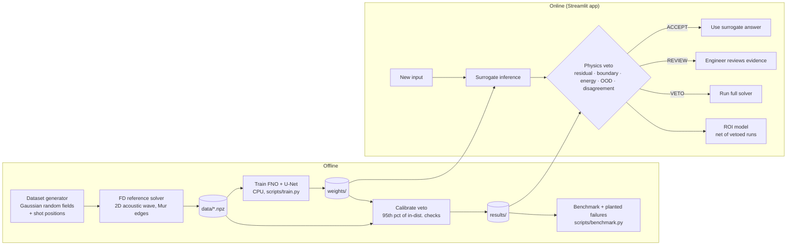

# Architecture

## Data encoding
For each of 8 anchor time steps *n*, the surrogate predicts three channels:
`p0 = p[n]`, `d1 = (p[n+1] − p[n−1]) / 2`, `d2 = p[n+1] − 2p[n] + p[n−1]`.
Predicting the time differences directly, instead of three raw snapshots, keeps the network's errors from being
amplified when the PDE residual takes a second time derivative. It also gives the energy check a velocity
field (`d1/dt`) and the boundary check the `p[n+1]` it needs.

## The checks (`physicsveto/verify/`)
| Check | What it computes | Needs the reference? |
|---|---|---|
| PDE residual | `d2 − (vΔt)² ∇²p0 − source` on interior cells, relative to `(vΔt)² ∇²p0` | No |
| Absorbing boundary | Mismatch of Mur's one-way wave condition along all four edges | No |
| Energy conservation | Growth of discrete acoustic energy after the source stops | No |
| OOD distance | Mahalanobis distance of input features (velocity stats, roughness, max gradient, shot position) from training | No |
| Model disagreement | Relative L2 difference between FNO and U-Net | No |

Each raw metric is divided by its 95th percentile on in-distribution validation predictions
(`results/calibration.json`). A ratio of 1 means "as good as normal". Sub-scores fall linearly to zero at a
per-check hard limit, and any hard-limit breach forces a VETO. Weights and limits are in `config/veto.yaml`.

## Cases B and C (steady elliptic problems)
`physicsveto/solvers/elliptic.py` solves −∇·(k∇u) = f, u = 0 on the boundary, with the same discrete operator
the veto uses (`apply_operator`), so a solver output has a round-off residual and its boundary flux balances the
sources exactly. `physicsveto/verify/steady.py` reuses the Case A scoring (`trust.score_metrics`) with:

| Check | What it computes |
|---|---|
| PDE residual | RMS of A(u) − f on interior nodes, relative to RMS(f) |
| Boundary | max |u| on the boundary ring, relative to max |u| |
| Conservation | mismatch between boundary outflux and injected h²Σf (heat or fluid balance) |
| OOD distance | Mahalanobis distance of k and f statistics (contrast, roughness, source power, edge share, anisotropy) |
| Model disagreement | FNO vs U-Net relative L2 |

Levels are calibrated per case (`results/case_b/calibration.json`, `results/case_c/calibration.json`);
weights and limits are in `config/veto_steady.yaml`.

## LLM drafting (optional)
`physicsveto/gtm/llm.py` calls the Claude API (`claude-opus-5-5`, server-side model fallbacks on) only when
`PHYSICSVETO_MOCK=0` and `ANTHROPIC_API_KEY` are set. The model receives the template text and the measured
numbers from `results/` and is told to use no other numbers. Output is labelled "LLM-drafted" in the app.

## Scaling on the NVIDIA stack
The demo runs on CPU at 64×64. The same workflow maps onto GPU infrastructure without changing the veto
interface:

| Layer | Demo (built) | Production path (not run here) |
|---|---|---|
| Surrogate model | `FNO2d` in plain PyTorch | `physicsnemo.models.fno.FNO(dimension=3)` from NVIDIA PhysicsNeMo (signature checked against v2.2.2) |
| Training | Single-process CPU loop | `physicsnemo.distributed.DistributedManager` + PyTorch DDP across GPUs |
| Checkpoints | `torch.save` state dict | PhysicsNeMo `Module.save` / `Module.from_checkpoint` |
| Residual checks | NumPy stencils | Same stencils as batched GPU convolutions (torch or CuPy) |
| Data | `.npz` files | Sharded arrays; GPU dataframes (cuDF) for run metadata and OOD features (TODO: verify fit) |
| Visualization | Plotly heatmaps | 3D review of vetoed cases, e.g. in Omniverse (TODO: verify connector) |

`physicsveto/backends/physicsnemo_backend.py` holds the adapter stub. It is not executed in this repo.
